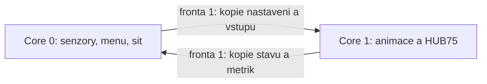

# ProtoFace portal - C++

Samostatny PlatformIO projekt pro **Adafruit MatrixPortal S3**, Arduino framework
od Espressif. Funkcni specifikace: [puvodni README](../src/README.md), zejmena
UC01-UC16. Puvodni Python firmware zustava v `../src/`.

## Co je preneseno

- HUB75 128x32, obe sady regionu, zrcadleni, RGB565, G/B swap a jas.
- Vsech 15 dostupnych menu emotes vcetne UwU/OwO, Clock, ZTRACENY s puvodnim
  znakem Y s carkou a Slots; puvodni obrazky i fontove tabulky.
- BMP loader (nekomprimovane 1/4/8/24/32 bit), sdilena cache predgenerovanych
  MPH1 prechodu, opacny smer a preskakovani zpozdenych snimku.
- Casove Smooth Speak, mic hysterese/hold, Speak Override, boop,
  adaptivni threshold/kalibrace, blink, rainbow a pohyb obliceje.
- OLED menu vcetne zalamovani, fontu 1.5x/2x/2.5x a deduplikace framebufferu.
- ADS1115/MAX9814, LIS3DH, APDS9960; detekce chybejicich senzoru a obnovení.
- PWM ventilatoru, runtime nastaveni v NVS a import PFS1/PFS3/PFS4.
- AP/STA, zalozni Wi-Fi profil, mDNS ve STA, ESP-NOW prijem 7/8 B,
  puvodni web a vsechny aktivni HTTP endpointy, browser time/NTP, profiler.

Zakomentovane menu Gif/Dice/Color v Pythonu nema dodane GIF assety a neni
soucasti aktivni funkcionality podle README. C++ neobsahuje nepouzivany obecny
GIF prehravac. Vsechny dostupne emotes jsou preneseny.

## Knihovny a zdroje

Verze jsou uvedene v [platformio.ini](platformio.ini). Pouzivaji se ovladace
primo od vyrobce, nikoliv vlastni alternativy pro HUB75/I2C/sit:

| Oblast | Knihovna / zdroj |
|---|---|
| HUB75 | [Adafruit Protomatter](https://github.com/adafruit/Adafruit_Protomatter) 1.7.1 |
| OLED | [Adafruit SSD1306](https://github.com/adafruit/Adafruit_SSD1306) 2.5.15, Adafruit GFX |
| Akcelerometr | [Adafruit LIS3DH](https://github.com/adafruit/Adafruit_LIS3DH) 1.3.0 |
| ADC mikrofonu | [Adafruit ADS1X15](https://github.com/adafruit/Adafruit_ADS1X15) 2.6.2 |
| Proximity | [Adafruit APDS9960](https://github.com/adafruit/Adafruit_APDS9960) 1.3.1 |
| Wi-Fi, HTTP, mDNS, NVS, LittleFS, RTC | [Espressif Arduino core](https://github.com/espressif/arduino-esp32) 2.0.17, ESP-IDF ESP-NOW/FreeRTOS |
| JSON | [ArduinoJson](https://github.com/bblanchon/ArduinoJson) 7.4.2, knihovna autora projektu |

PlatformIO platforma `espressif32@7.0.1` pouziva Arduino core 2.0.17.
ArduinoJson neni knihovna Adafruit/Espressif; je to primo upstream JSON parser.
Fonty a data obrazku pochazeji z tohoto projektu; nejsou nahrazene fontem GFX.
`fonts.h` lze obnovit explicitnim synchronizacnim skriptem.

Zapojeni bylo porovnano s oficialnim
[prikladem Protomatter](https://github.com/adafruit/Adafruit_Protomatter/blob/master/examples/simple/simple.ino),
[CircuitPython board definici](https://github.com/adafruit/circuitpython/blob/main/ports/espressif/boards/adafruit_matrixportal_s3/pins.c)
a [Arduino variantou](https://github.com/espressif/arduino-esp32/blob/master/variants/adafruit_matrixportal_esp32s3/pins_arduino.h).

| Funkce | GPIO |
|---|---|
| R1/G1/B1/R2/G2/B2 | 42/41/40/38/39/37 |
| A/B/C/D adresy HUB75 | 45/36/48/35 |
| CLK/LAT/OE | 2/47/14 |
| SDA/SCL | 16/17 |
| Confirm/Next/Prev | 6/7/11, INPUT_PULLUP |
| Fan A1 | 3, 25 kHz |

## Soubory

```text
src/main.cpp       startup a logic task (core 0), HTTP/ESP-NOW/Wi-Fi, nastaveni
src/animation.cpp  animation task (core 1), vlastnictvi Face/Graphics a fronty
src/core.cpp       hardwarove nezavisle menu, boop, emote, perzistencni format
src/graphics.cpp   BMP/MPH loader, cache, vrstvy, dynamicke obrazky, Protomatter
src/services.cpp   senzory, OLED, konfigurace/NVS, hodiny a metriky
include/           rozhrani, hodnotove snapshoty animation_state.h, puvodni fonty
data/faces/        kopie puvodnich BMP
data/transitions/  kopie 51 puvodnich MPH1 souboru
data/static/       puvodni webove ovladani
settings.example.toml
test/              nativni C++ testy
scripts/           host testy, synchronizace assetu, build preflight
partitions.csv     3 MiB aplikace, 1 MiB LittleFS, zachovana TinyUF2 oblast
```

## Sestaveni

Z korene repozitare:

```powershell
Copy-Item src_c/settings.example.toml src_c/data/settings.toml
# Uprav src_c/data/settings.toml podle sveho zapojeni a site.
pio run -d src_c
pio run -d src_c -t buildfs
python src_c/scripts/test_host.py
```

Prikaz Copy-Item spoustej pouze pro novou konfiguraci; existujici soubor
obsahuje tvoje credentials. Soubor je ignorovany Gitem a sync ho neprepisuje.
Bez nej firmware pouzije vychozi volby: AP `Alan_Protogen-`, hostname `protogen`,
zapnute displeje/senzory, jas 0.5, fan 0. Pro stavajici controller pouzij stejny
`AP_SSID` jako v jeho konfiguraci (priklad obsahuje `Alan Protogen`).

Konfigurace podporuje ploche TOML prirazeni klic=boolean nebo klic="text",
vcetne komentaru. Neni to obecny TOML parser: tabulky, multiline retezce,
escape sekvence a slozene hodnoty nejsou podporovane. Vsechny klice z
`settings.example.toml` i volby `BLINK_ON`/`DISPLAY_ON` funguji.
Runtime volby v NVS maji pred TOML prednost, indexy Brightness/Font/Fan
se stejne jako v Pythonu nectou z TOML.

Build je samostatny: nepotrebuje Python firmware ani generator. Po zmene
puvodnich BMP nejprve regeneruj prechody a potom explicitne synchronizuj:

```powershell
python tools/generate_transitions.py
python src_c/scripts/sync_assets.py
pio run -d src_c -t buildfs
```

## Nahrani na desku

Z korene repozitare lze firmware i filesystem sestavit a nahrat jednim prikazem:

```powershell
.\deploy_portal_c.ps1
.\deploy_portal_c.ps1 -Port COM7 -Monitor
```

Skript vyzaduje `pio` a lokalni `src_c/data/settings.toml`, ktery neprepisuje.
Automaticky vyhleda port; pri vice moznych deskach vyzaduje `-Port`.
Po nahrani firmware port znovu vyhleda, protoze se pri resetu muze zmenit.
`-Monitor` otevre serial na 115200 baud. `-FirmwareOnly` preskoci build/upload
filesystemu (pouzij jen pokud uz jsou na desce spravne assety a konfigurace).
`-BuildOnly` pouze sestavi obrazy a nic nenahraje. Selhani libovolneho kroku
zastavi dalsi nahravani. Skript pouziva cestu sveho umisteni, nezavisi na cwd.

Firmware i filesystem jsou dva oddelene obrazy. Arduino firmware nahrazuje
CircuitPython runtime; Python soubory z CIRCUITPY uz nespousti. Pred prechodem
si z CIRCUITPY uloz vlastni settings a pripadne export NVM. Pri prvnim portu
se nespoléhej na automaticke zachovani jeho filesystemu/NVM.

Zvol aktualni port misto prikladoveho COM5:

```powershell
pio run -d src_c -t upload --upload-port COM5
pio run -d src_c -t uploadfs --upload-port COM5
pio device monitor -d src_c --port COM5 --baud 115200
```

Prvni start pred uploadfs muze vypsat chybu mountu/assetu; po nahrani filesystemu
desku restartuj. Pri nenalezenem portu pouzij BOOT/reset postup pro MatrixPortal S3.
`partitions.csv` ponechava TinyUF2 na 0x410000 s velikosti 0x40000. LittleFS je
na 0x310000, velikost 0x100000. Nejde o Arduino OTA aktualizace: projekt obsahuje
jeden aplikacni slot a TinyUF2 factory slot.

Runtime mountuje oddil explicitne jako
`LittleFS.begin(false, "/littlefs", 10, "littlefs")`, podle nazvu v partitions.csv.
Vychozi Arduino partition label `spiffs` tomuto rozlozeni neodpovida.
Serial pri startu vypise obsazenost filesystemu a velikost povinneho
`mouth--mouth_speak.mph`. Pokud je mount uspesny, ale soubor chybi, nahraj
filesystem pres `uploadfs`; pri chybe mountu over take nahranou partition table.

Pri startu serial vypise STA MAC pro controller a dostupnou HTTP IP. V AP rezimu
pouzij IP, mDNS je jen ve STA. Controller musi mit tuto MAC a stejny kanal.
AP/STA jsou pro uzivatele vzajemne vyloucene; radio zustava AP_STA kvuli
ESP-NOW na station interface. Po odpojeni site bezi otevreny fallback AP na
kanalu 1 bez HTTP, stejne jako v referencnim runtime.

Zachovani voleb pri prechodu: z CircuitPython REPL lze jeste pred flashnutim
exportovat `bytes(microcontroller.nvm[:9])` jako binarni `runtime.pfs`.
Vloz ho do `src_c/data/runtime.pfs` a sestav filesystem. Prvni boot ho importuje,
jen pokud v NVS neni platny zaznam, a ulozi aktualni PFS4 do NVS. Pri dalsich
startech ma NVS prednost. Bez exportu zacnes s TOML/defaulty.

## Casovani a vedome rozdily proti Pythonu

- Logicky tick je **50 ms**, podle priblizne 50-55ms smycky popsane v puvodnim
  README. Blink 125 zpusobilych kroku, boop 5 a blink trvani 16 kroku
  zustavaji pocitadlove. Pri pretezene smycce se nedohaneji v davce.
- Casove prechody a Smooth Speak pouzivaji skutecny monotonic cas 200 ms;
  renderovaci uloha je posouva s cilovym intervalem 10 ms. Rozhodovani o
  mluveni a regiony ma spolecny 50ms logicky tick pro oba fyzicke panely.
- Kalibrace mikrofonu a akcelerometru sbira 20 vzorku v logickych ticich a
  neblokuje po dobu sekundy zbytek firmware. Chybejici hodnoty jsou neplatne,
  nikoliv nuly. Obnova chybejiciho senzoru se zkousi nejvyse 1x/s.
- Wi-Fi STA pokusy jsou asynchronni, 10 s na profil; behem pripojovani funguje
  oblicej i menu. Zmeny site z HTTP se provedou po odeslani odpovedi, aby se
  nezrusil prave obsluhovany klient.
- Pro 25 kHz ventilator se pouziva fyzicke **10bit LEDC** rozliseni, duty 0..1023.
  Arduino na S3 voli 40MHz XTAL; 11 bitu pri 25 kHz by inicializaci zneplatnilo.
  Inicializace se kontroluje a `/api/perf` vraci `fan_pwm_ready` a `fan_percent`.
  Vychozi Fan=0 znamena vypnuto; pro zkousku nastav Settings -> Fan na 100 %.
  CircuitPython
  16bit duty_cycle je logicka skala, nikoliv pozadavek na 16bit casovac pri 25 kHz.
  Uzivatelske kroky zustavaji 0/50/100 %.
- RTC bezi v systemovem case ESP32. NTP ma pevny offset +2 a muze se opakovane
  synchronizovat pres systemovy SNTP; browser posila lokalni datum bez dalsiho
  posunu. Neni automaticke prepinani letniho/zimniho casu. Neplatne datum je
  odmitnute, chybejici NTP neshodi aplikaci.
- Dlouhotrvajici kumulativni pohyb je saturovany na +/-4096 px, aby signed
  souradnice nepretekly; navrat do klidu stale obnovi vychozi pozice.
- UI zustava vazane na dostupne OLED stejne jako v Pythonu. Web bez OLED vrati
  menu_snapshot_unavailable. Nepouzivane GIF vetve se neportovaly.
  Orientace SSD1306 pouziva stejne hardwarove prikazy 0xA0/0xC0 jako Python,
  aby odpovidala fyzickemu uchyceni OLED.
- `Display OFF` uvolni Protomatter i obrazove cache. Pri zapnuti/jasu se obnovi
  display stack a casovani emotes. Rainbow pracuje na puvodnich barvach a jas
  se neaplikuje dvakrat.
- `mem_free`/`mem_alloc` jsou ESP-IDF 8bit heap metriky; nejde o CircuitPython GC
  cisla. Hlavni profil zahrnuje aktivni sekce logic task; animace maji vlastni
  profil. `load_pct` neni celkove vytizeni obou CPU.

## Automaticke pripojeni k domaci Wi-Fi

Do lokalniho `src_c/data/settings.toml` vypln `HOME_WIFI_SSID` a
`HOME_WIFI_PASSWORD` (pripadne i `BACKUP_WIFI_SSID`/`BACKUP_WIFI_PASSWORD`).
Konfiguraci nahraj pres `deploy_portal_c.ps1` nebo PlatformIO `uploadfs` a
restartuj desku. Hesla zustavaji v ignorovanem lokalnim souboru/filesystemu,
nevypisuji se do diagnostiky.

Na OLED otevri **Settings -> Wifi_Connect -> ON**. Volba se ulozi do NVS
a po restartu se znovu pokusi pripojit. Pri neuspechu se automaticky prepne na AP:

1. Nejprve se zkusi domaci profil, nejvyse 10 s.
2. Druhy pokus pouzije zalozni profil. Pokud je vyplneny pouze jeden profil,
   zkusi se stejna sit podruhe; prazdne profily se nepocitaji jako pokusy.
3. Po **dvou neuspesnych pokusech** se vypne Wifi_Connect a zapne Wifi_Broadcast.
   Spusti se vlastni AP podle AP_SSID/AP_PASSWORD, kanal 1, vcetne HTTP serveru.
   Obe volby se ulozi do NVS, takze dalsi restart zustane v Broadcast rezimu.
   Bez jedineho vyplneneho SSID se Broadcast spusti ihned.
4. Uspech vynuluje pocitadlo. Pri pozdejsi ztrate spojeni zacnou nove dva
   pokusy. Dva timeouty trvaji priblizne 20 s plus rezije Wi-Fi operaci.
5. Pro dalsi zkousku domaci site znovu zapni Wifi_Connect; z Broadcast rezimu
   se uz domaci sit nezkousi automaticky. Rucni prepnuti rezimu pokusy zrusi.

Wifi_Connect ON znamena povolene automaticke pripojovani, nikoliv potvrzeni,
ze je router prave dostupny. `Wifi_Broadcast` je alternativni rezim vlastniho AP;
zapnuti jednoho rezimu vypne druhy. Kdyz je zapnuty Broadcast, domaci profil
se nezkousi. Pri pripojeni domaci siti je web na IP vypsane do serialu nebo
`http://protogen.local/` (pokud hostname nebyl zmenen a funguje mDNS).

`/api/perf` obsahuje objekt `wifi`: `connect_enabled`, `station_connected`,
`connecting`, `attempt`, `max_attempts`, `profile` (posledni zvoleny profil) a `ip`.
Uspech neprepisuje ulozenou volbu; automaticky prechod po druhem neuspechu
ulozi Wifi_Connect OFF / Wifi_Broadcast ON.
Zabudovany SDK auto-reconnect je vypnuty, aby nesouperil s prepinanim profilu.
Pokusy o pripojeni take neukladaji znovu credentials do SDK NVS.

Overeno na desce 28. 10. 2026: po zapnuti Wifi_Connect se pripojil domaci
profil (`connect_enabled=true`, `station_connected=true`, `profile=main`)
a HTTP preslo na IP domaci site. Vypadek routeru a navrat do dosahu zatim
nebyly fyzicky zkousene; limit dvou pokusu a reset pocitadla maji host test.

## Kasino Slots a vysledek na OLED

Emotes -> Slots a novy boop spusti tri svisle rolujici valce. Kazdy valec ma
vlastni pozici a kubicke zpomalovani; zastavi se po 1.7 / 2.2 / 2.7 s.
Okno valce oreze sousedni symboly, zlaty ram ma bezici svetla a stredovou
vyherni linku. Symboly: 7, BAR, tresne (CHERRY), zvonek (BELL), diamant (GEM),
hvezda (STAR). Pri shode ram 1.6 s blika.

Vysledek se urci pri zacatku spinu, animace k nemu dojede. Rychlost smycky
ani zpozdeny snimek nemeni cilove symboly. Podrzena ruka neroztaci znovu;
dalsi boop behem toceni se ignoruje. Odchod ze Slots roztočení zrusi.
Dokonceny vysledek zustava do dalsiho spinu/obnoveni display stacku;
restart ho neuklada do NVS.

Vnitrni OLED ma pro Slots vlastni kompaktni 1x sazbu: TOCENI, tri radky se
symboly, vysledek a navrat. Ostatni menu zachovavaji zvoleny Font.
Dosud nezastavene valce maji `...`. Vysledek je BEZ VYHRY / DVOJICE / TROJICE;
tri sedmicky znamenaji JACKPOT. Nejsou penize, kredity ani sazky.

Animacni jadro predava hodnotovy SlotSnapshot pres existujici frontu.
OLED zustava na logic jadre a odesila I2C framebuffer jen pri zmene.
Vykreslovaci canvasy jsou predalokovane a opakovane se pouzivaji.
`/api/menu` v detailu Slots i `/api/perf` obsahuji objekt `slots` se symboly,
spin_id, spinning, has_result a result. Webove menu zobrazuje i vysledek.

## Restart desky z menu

**Settings -> HW Reset -> OK** restartuje ESP32-S3 pres `ESP.restart()`.
Polozka je take dostupna pres stejne webove ovladani menu a z ESP-NOW controlleru.
Je to jednorazova akce oznacena `RUN`; nema persistentni bit a nemeni ulozene
nastaveni, credentials ani filesystem. Restart nastane po 300 ms z logic task,
az po navratu z HTTP handleru, aby se stihla odeslat odpoved. Opakovany stisk
neposouva naplanovany restart. Po restartu se znovu inicializuji obe ulohy
a periferie. Jde o restart mikrokontroleru, nikoliv odpojeni napajeni cele masky.

## Leva a prava RGB matice

Zapojeni masky je **ESP -> levy 64x32 panel -> pravy 64x32 panel**.
Mapovani kazde strany je explicitne v `include/panels.h`:

| Panel | Sloupce framebufferu | Dilci regiony obliceje | Fullscreen text/symboly |
|---|---|---|---|
| Levy, prvni v retezci | 64..127 | puvodni nezrcadlena souradnice | bez zrcadleni |
| Pravy, druhy v retezci | 0..63 | puvodni vodorovne zrcadleni | bez zrcadleni |

Fyzicke poradi v retezci se nesmi zamenit s poradim polovin framebufferu:
uzivatelsky test potvrdil, ze prvni pokus upravil opacny panel. Fullscreen se
proto vykresluje bez vodorovneho zrcadleni v obou logickych polovinach.
Oblicej nadale pouziva puvodni symetricke mapovani kolem nosu.
Oprava zahrnuje Clock, Name, UwU Full
a Slots; neprevraci osu Y ani poradi panelu. Oci/pusa/nos se touto textovou
korekci nemeni. Kazda strana ma vlastni 64x32 viewport, aby pri pohybu pixely
nepretekaly do druheho fyzickeho panelu.

Bitmapy a snimky morphu mohou zustat sdilene; na fyzicky panel se mapuji
az pri vykresleni. Neni treba regenerovat BMP/MPH nebo nahravat filesystem.
Pri overeni zvol Emotes -> Name a Clock, zkontroluj citelnost zvenku z obou
stran a potom idle oblicej, aby nos zustal u predniho okraje masky.

Rozliseni symetrickeho obliceje a citelnych textovych obrazovek pouziva take
[MochiiTracer](https://github.com/mochiitheproto/mochiitracer); skutecna
orientace nasi masky je nastavena podle zde potvrzeneho zapojeni a symptomu.

## Dve jadra a predavani stavu

Pouziva se primo oficialni ESP-IDF FreeRTOS
[`xTaskCreatePinnedToCore`](https://docs.espressif.com/projects/esp-idf/en/v4.4.7/esp32s3/api-reference/system/freertos.html).
Obe ulohy se vytvareji explicitne; Arduino loop task se po setup sam ukonci.

| Uloha | Jadro | Priorita | Stack | Cilovy interval | Vlastnictvi |
|---|---|---|---|---|---|
| proto_logic | 0 | 1 | 16384 B | 50 ms | senzory, I2C/OLED, menu, nastaveni/NVS, fan, Wi-Fi/HTTP a prijem ESP-NOW |
| proto_animation | 1 | 2 | 12288 B | 10 ms render, 50 ms logicky tick | Face, Graphics, RGB framebuffer, Protomatter, BMP/MPH cache |

Jde o cilove intervaly, nikoliv zaruku FPS. Obe ulohy po kazde iteraci
blokujici cekaji, pri prekroceni rozpoctu alespon jeden RTOS tick.
Nedohaneji zpozdeni v tesne smycce. Wi-Fi a systemove ulohy FreeRTOS bezi dal.
Protomatter se inicializuje i uvolnuje vyhradne z animation task, takze i jeho
timer/ISR vznikaji na stejnem jadre jako renderer.



- Komunikace pouziva dve FreeRTOS fronty o jedne polozce, `xQueueOverwrite`
  pro publikaci nejcerstvejsiho stavu a receive/peek pro konzistentni kopii.
  Stare snapshoty se nehromadi, cteni/zapis neceka na zpracovani druhe ulohy.
- Zpravy obsahuji pouze hodnoty: Settings, Sample, ID emote, threshold,
  timestamp, revize zmen a pevna pole pro text. `static_assert` overuje, ze
  jsou trivially copyable. Nepredava se String, pointer, reference ani bitmapa.
- Jas a Display OFF/ON pouze zmeni pozadovany stav a revizi. Obnoveni/uvolneni
  Protomatter a cache provede vyhradne animation task. Stejne se predava
  dokonceni morphu pri vypnuti Smooth Transitions. I nekolik rychlych zmen
  sloucenych do jednoho snapshotu zachova pozadavek na obnoveni stacku.
- Boop tracker na core 0 dostava informaci o aktivnim boopu z vystupni fronty.
  Nikdy necte zive regiony Face z druheho jadra.
- Kdyz je vzorek senzoru starsi nez **250 ms**, animační uloha ho oznaci
  jako neplatny. Zaseknuty HTTP klient nebo pomaly OLED tak nenecha stale
  aktivni mluveni/boop/pohyb podle stare hodnoty. Menu, nastaveni a posledni
  text hodin zustavaji platne; blink, Slots a dobehy animaci pokracuji.
- Zvetseni render frekvence nezrychluje blink, kumulativni pohyb ani
  rainbow: jejich citace se meni jen v 50ms logickem ticku. `Face::animate`
  mezi ticky interpoluje usta a casove valce Slots, bez prodluzovani mikrofonniho hold.
- LittleFS se mountuje pred startem animation task a pak se jen cte,
  kazda uloha ma vlastni File handle. Menu a vsechny I2C pristupy patri pouze
  logic task. JSON i logovaci buffer take zustavaji v jedne uloze.
- Selhani alokace tasku/front se vypise na serial a inicializace se zastavi.
  Jednojadrovy FreeRTOS build je odmitnut pri kompilaci.

`GET /api/perf` zachovava dosavadni pole pro logic task a pridava:

- `logic_core`, `logic_stack_free_bytes`;
- `animation.core`, `ready`, `frames`, `logical_ticks`;
- `animation.period_avg_ms`, `period_max_ms`, `work_avg_ms`, `work_max_ms`;
- `animation.stack_free_bytes`, `input_stale`, `status_age_ms`, `error`.

Prumer/max animaci se uklada po 5 s. `frames` pocita iterace render ulohy,
nikoliv fyzicke skenovani HUB75; nezmeneny framebuffer se znovu neposila.
`stack_free_bytes` je minimum dosud volneho stacku podle ESP-IDF high-water mark.
Core ID a stav jsou hodnoty skutecne vracene ulohami, ne jen konstanty z konfigurace.

Overeni na desce: `/api/perf` musi ukazovat `logic_core=0` a `animation.core=1`.
Behem zmeny Wi-Fi a dlouheho OLED renderu musi rust animation.frames; sleduj
take period_max_ms, status_age_ms a rezervu obou stacku. Otestuj opakovane
Brightness a Display OFF/ON, mic hold pri zpomalene logice a prepinani fullscreen.
Zapis do flash/NVS a preruseni mohou ovlivnit obe jadra; fyzickou plynulost je
treba stale zmerit na panelu.

## Overeni a stav

Host overeni **27. 10. 2026**:

- sestaveni firmware pro skutecny ESP32-S3 target;
- sestaveni LittleFS obrazu s puvodnimi 18 BMP, 51 MPH a webem;
- dvanact skupin C++ testu: verze/perzistence, ESP-NOW a menu, boop tracker,
  priority emotes/mic/Slots/blink, barvy/casovani, navraty regionu pres morph,
  snapshoty/stari vstupu/tick, nezavisla interpolace bez posouvani citacu
  limit dvou Wi-Fi pokusu s resetem pocitadla a akce/odlozeni HW Reset
  vcetne preteceni millis a nezavisle mapovani panelu s asymetrickym vzorem
  a kontrolou hranic viewportu, casove valce/vysledky Slots vcetne zpozdeni,
  preteceni millis, poradi zastaveni a boop latch;
- kontrola vsech MPH1 hlavicek, poctu snimku a souradnic;
- SHA-256 shoda assetu s aktualni Python referenci.

Overeni startu na desce **28. 10. 2026**: po oprave explicitniho partition
labelu byl firmware nahran na MatrixPortal S3. Serial potvrdil mount LittleFS
`380928/1048576` B, povinny mouth prechod `7113` B, start HTTP AP a obou uloh.
Uzivatel potvrdil rozsviceni RGB matice. To overuje start a dostupnost assetu;
nepotvrzuje vsechny senzory, kvalitu animaci ani skutecnou rezervu pameti.

Host testy potrebuji `g++` nebo `clang++` v PATH. Python zde pouze spousti
kompilator/testy a kontroluje soubory, na desce zadny Python nebezi.

**Zbyva overit na hardwaru:** mereni soubehu jader, vizualni porovnani,
mereni runtime RAM a zkouska senzoru/controlleru. Pred pouzitim projdi
UC01-UC16 z puvodniho README, zejmena barvy/zrcadleni obou panelu, otoceni
Smooth Speak v prubehu animace, dlouhe OLED polozky, restarty s NVS a soubeh
Wi-Fi/rainbow/Slots. Velikost `.data/.bss` z kompilatoru neni runtime RAM
vcetne bitmap, cache, Wi-Fi a Protomatter bitplanu.
